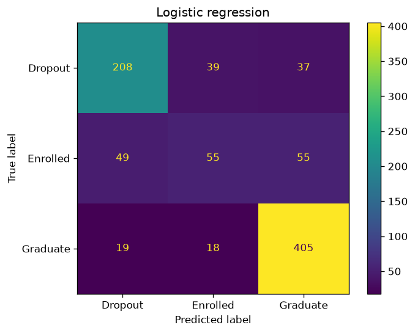

# Student Dropout Prediction

Machine learning on 4,424 higher-education students to predict whether a student drops out, is still enrolled or graduates. The project also predicts the second-semester grade and segments students with unsupervised learning. It covers the full workflow: data validation, feature engineering, leakage control, model selection with cross-validation, and evaluation on a held-out test set.

Final project for Machine Learning (ICAI).

## Data

[Predict Students' Dropout and Academic Success](https://archive.ics.uci.edu/dataset/697/predict+students+dropout+and+academic+success), from the UCI Machine Learning Repository (Realinho et al., 2021, CC BY 4.0). It has 36 features per student: demographic, socioeconomic, admission, first- and second-semester performance, and macroeconomic indicators. The target has three classes: `Dropout`, `Enrolled` (still enrolled at the end of the normal course duration) and `Graduate`.

`scripts/download_data.py` downloads the original file and checks its SHA-256. `src/preprocessing.py` renames the columns to snake_case (for example `grade_1st`, `units_2nd_approved`, `admission_grade`) and groups the categorical codes using the variable descriptions published by UCI.

Class balance: 49.9 % graduate, 32.1 % dropout, 17.9 % still enrolled.

## Approach

1. **EDA** (`01_eda.ipynb`): distributions, outcome by variable, correlations.
2. **Preprocessing** (`02_preprocessing.ipynb`, `src/preprocessing.py`):
   - Consistency checks, and grouping of high-cardinality codes (parents' qualification and occupation) before one-hot encoding.
   - Engineered features: pass ratio per semester, grade change between semesters, total enrolled units, and both parents with higher education.
   - An 80/20 stratified split. The age outlier cap (99th percentile) is estimated on the training set only.
3. **Classification** (`03_classification.ipynb`):
   - Five models: logistic regression, random forest, k-NN, RBF SVM and an MLP.
   - k-NN and SVM hyperparameters are tuned with 5-fold CV on macro F1.
   - The models are compared both on the test set and with stratified 5-fold CV on the training set.
4. **Regression** (`04_regression.ipynb`):
   - Target: the second-semester average grade, predicted from enrolment and first-semester data.
   - Every second-semester variable, and every feature derived from one, is excluded to prevent target leakage.
   - Models: OLS as baseline, then Ridge and Lasso (penalty chosen by 5-fold CV) and a random forest.
5. **Unsupervised** (`05_clustering.ipynb`): PCA, and k-means with k chosen by inertia and silhouette.

## Results

All figures below come from running the notebooks in order.

**Classification**

| Model | Test accuracy | Test macro F1 | Test F1 (enrolled) | CV macro F1 (5-fold) |
|---|---|---|---|---|
| Logistic regression | 0.755 | 0.670 | 0.406 | **0.698 ± 0.015** |
| Random forest | **0.789** | **0.713** | **0.469** | 0.694 ± 0.020 |
| MLP | 0.748 | 0.662 | 0.376 | 0.686 ± 0.012 |
| SVM (RBF) | 0.762 | 0.675 | 0.412 | 0.679 ± 0.014 |
| k-NN | 0.668 | 0.575 | 0.295 | 0.594 ± 0.019 |

The test set has 885 students. Always predicting the majority class (graduate) would give 0.499 accuracy. On the test split the random forest scores highest, but in cross-validation logistic regression and the random forest are within one standard deviation of each other, so the data does not separate the two. The hardest class for every model is *still enrolled*: it is the smallest class and lies between the other two outcomes.



*Confusion matrix of the logistic regression on the test set.*

The classifiers use second-semester performance, so they predict the outcome at the end of the first year rather than at enrolment.

**Regression: second-semester grade**

| Model | RMSE | MAE | R² |
|---|---|---|---|
| Lasso (α = 0.01) | **2.583** | 1.540 | **0.754** |
| Linear regression | 2.589 | 1.550 | 0.752 |
| Ridge (α = 100) | 2.595 | 1.565 | 0.751 |
| Random forest | 2.710 | 1.422 | 0.729 |

The linear models outperform the random forest on RMSE and R². The random forest has a lower MAE but a higher RMSE: its typical error is smaller, but it makes more large errors, which RMSE penalises quadratically. In every model the largest errors come from the 173 test students (19.5 %) whose second-semester average is 0. For Lasso, the MAE is 2.629 on those students and 1.275 on the rest.

**Clustering**: k = 3 gives the highest silhouette score (0.367). One cluster of 906 students, with almost no approved first-semester units (0.46 on average), contains 82.2 % dropouts. The overall dropout rate is 32.1 %.

## Corrections relative to the submitted version

- The "both parents with higher education" feature compared raw labels with an already-grouped label, so it was always 0. It is now computed after grouping, and 261 students have the flag.
- The age cap used the 99th percentile of the whole dataset before the split. It is now estimated on the training set only.
- In the regression task, the total number of enrolled units (1st + 2nd semester) contained second-semester information. It is now excluded.
- Two skilled-trade occupation codes were grouped as low-skill. Code 171 was low-skill for mothers but medium-skill for fathers, and code 173, which only occurs among mothers, was also low-skill. Both now count as medium-skill.

The pipeline now works directly on the original UCI codes, which also changes the stratified split. The figures therefore differ slightly from the submitted report.

## How to run

Requires Python 3.10+.

```bash
pip install -r requirements.txt
python scripts/download_data.py      # downloads data/students.csv
jupyter notebook notebooks/          # run 01 → 05 in order
```

## Stack

Python, pandas, NumPy, scikit-learn, Matplotlib, seaborn, Jupyter.

## Reference

Realinho, V., Vieira Martins, M., Machado, J., & Baptista, L. (2021). *Predict Students' Dropout and Academic Success* [Dataset]. UCI Machine Learning Repository. https://doi.org/10.24432/C5MC89
